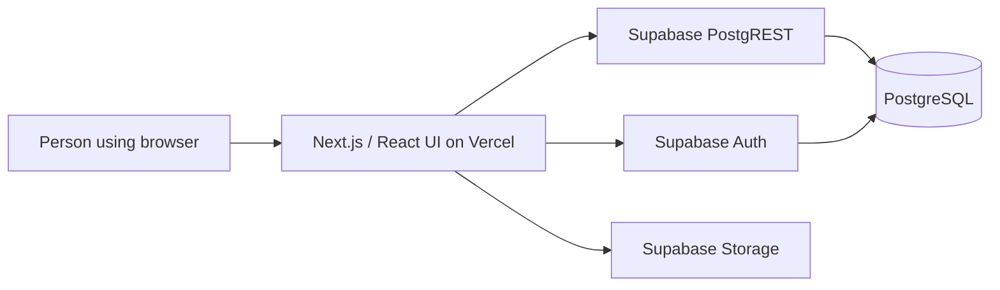

# Architecture

This document describes the implementation present in the repository as of October 2026. It is deliberately explicit about what can and cannot be verified from source.

## System overview

The current habit workspace is primarily a client-rendered React application. Browser requests go directly to Supabase using the configured **public/publishable** key and the signed-in user's access token. No server-side service-role key is needed in the frontend.

### Main code areas

| Path | Responsibility |
| --- | --- |
| `src/app/page.tsx` | Main application, authentication state, data loading, dialogs, and habit actions |
| `src/app/habit-metrics.ts` | Schedule evaluation and derived habit states, periods, and trends |
| `src/app/habit-views.tsx` | Weekly and monthly progress visualization |
| `src/app/use-quantity-counter.ts` | Quantity action coordination and recovery |
| `src/app/account-settings.tsx` | Profile management, credentials, avatar, and data export |
| `src/lib/avatar-url.ts` | Avatar URL utility |
| `src/app/*.css` | Layout, components, and visual tokens |
| `tests/*.test.mjs` | Automated behavior and source-level regression tests |

### Data and trust boundaries

The frontend reads and writes application data through Supabase APIs. Current resources referenced by the code include habits, habit entries, duration/work sessions, quantity events, schedule versions, entry revisions, and preferences. Account photos use a private Storage bucket.

- The **public key is not an authorization boundary**. Data access must be enforced by server-side database policies and functions.
- The production schema uses Supabase Row Level Security (RLS), as documented in the existing product/QA notes. This repository **does not contain a complete versioned schema** to reproduce or independently validate all production policies.
- Client-side session information is persisted in browser local storage. Review browser/session threat models before treating this as a hardened security posture.
- Correctness-sensitive actions (such as quantity undo) rely on database functions and their transaction guarantees. Frontend-only tests cannot replace database integration tests.

### Data consistency principles

1. Unrecorded, skipped, and explicitly missed are distinct states.
2. One shared state calculation is used to derive success where possible.
3. Repeated or stale mutations must not reverse newer confirmed data.
4. Historical schedule changes must not silently reinterpret old records.
5. Archiving retains history; confirmed permanent deletion does not.

See [data consistency QA](DATA_CONSISTENCY_QA.md) and [habit design decisions](HABIT_MRP.md) for the underlying behavior and tests.

## Known technical limitations

- **Large main component:** `page.tsx` currently mixes concerns and should be split into focused modules incrementally, with tests protecting behavior.
- **Missing versioned database migrations:** New contributors cannot provision a fresh, compatible Supabase backend from this checkout alone.
- **Fixed timezone:** The current interface uses `Asia/Dhaka` when computing habit days. Broader regional support requires a defined timezone and migration strategy.
- **Testing scope:** CI performs type checks, Node tests, and a production build; it is not a replacement for browser, accessibility, RLS, and multi-user integration testing.
- **No implemented calendar integration or advanced reminder service** in the current product.

These are documented engineering tasks, not claims that the product already solves them.
